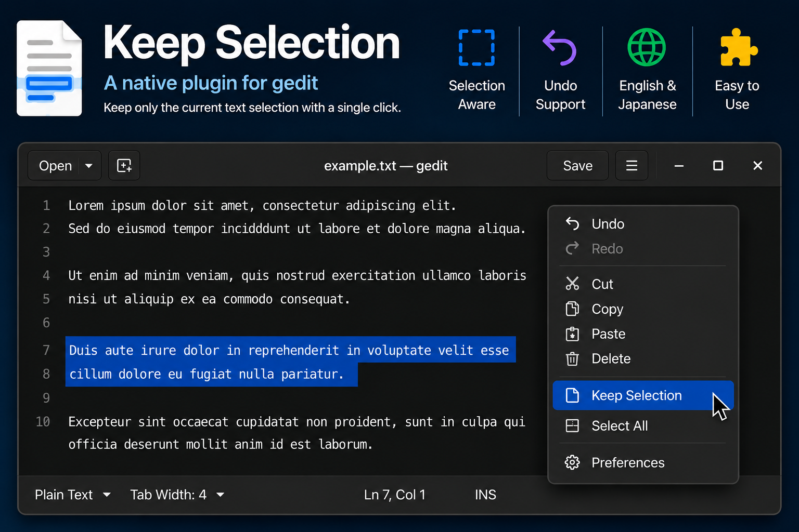

# Keep Selection

A plugin for **gedit 50** that keeps only the current text selection.

🇯🇵 Japanese documentation: [README_ja.md](README_ja.md)



## Features

- Keeps only the current text selection.
- Supports Undo.
- Accessible from the editor's context menu.
- Keyboard shortcut: **Ctrl+L**
- Available in English and Japanese.

## Installation

This prebuilt release is intended for the **Flatpak version of gedit 50**.

Copy the following files to:

```text
~/.var/app/org.gnome.gedit/data/gedit/plugins/
```

- `libkeepselection.so`
- `keepselection.plugin`

Restart gedit, then enable **Keep Selection** from the Plugins dialog.

## Building from Source

This repository contains the plugin source code.

Place the source directory in the `plugins/` directory of the gedit source tree, then build gedit.

## Acknowledgements

This plugin was developed independently.

While learning the gedit plugin architecture, the **Code Comment** plugin included with gedit served as a valuable reference.

Thanks to the gedit developers for providing a clean and well-structured example of plugin development.

## License

This project is licensed under the MIT License. See the [LICENSE](LICENSE) file for details.
