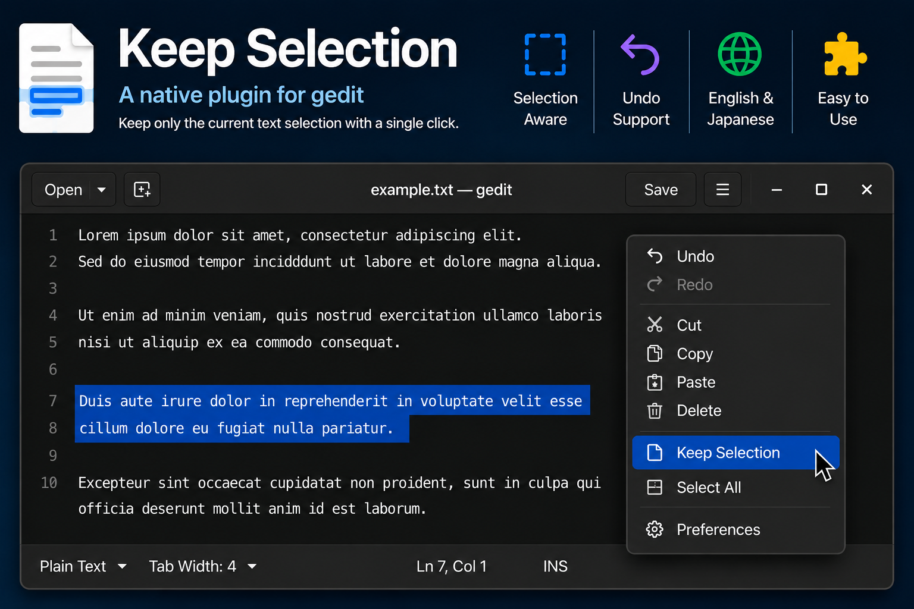

# Keep Selection

**gedit 50** 用のプラグインです。

選択範囲だけを残し、それ以外のテキストを削除します。

🇺🇸 English documentation: [README.md](README.md)



## 機能

- 選択範囲だけを残します。
- Undo（元に戻す）に対応しています。
- エディタの右クリックメニューから実行できます。
- キーボードショートカット: **Ctrl+L**
- 日本語と英語に対応しています。

## インストール

このリリースは **Flatpak版 gedit 50** を対象としています。

以下のファイルを

```text
~/.var/app/org.gnome.gedit/data/gedit/plugins/
```

へコピーしてください。

- `libkeepselection.so`
- `keepselection.plugin`

geditを再起動し、プラグイン一覧から **Keep Selection** を有効にしてください。

## ソースコードからビルド

このリポジトリにはプラグインのソースコードが含まれています。

ソースディレクトリを gedit のソースツリー内 `plugins/` に配置し、geditをビルドしてください。

## 謝辞

このプラグインは独自に実装したものです。

geditのプラグインアーキテクチャを学ぶにあたり、geditに付属する **Code Comment** プラグインを参考にしました。

分かりやすい実装例を提供してくださった gedit 開発者の皆さまに感謝します。

## ライセンス

このプロジェクトは MIT License のもとで公開しています。詳細は [LICENSE](LICENSE) をご覧ください。
